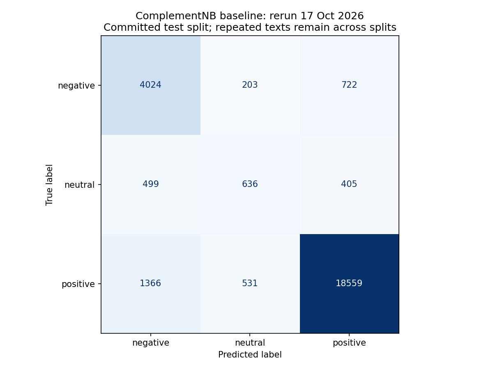
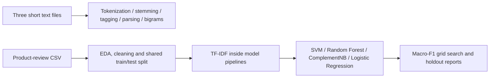

# Text analytics and sentiment classification

A four-person Asia Pacific University CT107-3-3-TXSA group project covering classical NLP and sentiment classification of product reviews. Part A explores tokenization, stemming, POS tagging, parsing and bigram language models on small texts. Part B compares four TF-IDF classifiers on shared cleaned review splits.

**Status:** notebook coursework with committed data and saved results. The Complement Naive Bayes baseline was rerun for this portfolio check; full hyperparameter grids and other model training were not rerun. The split contains substantial repeated text across training and test, so its scores are descriptive of this split and should not be treated as independent generalization estimates.



*Fresh evaluation on the committed 26,945-row test split, 17 October 2026. Generated by the original baseline pipeline cell. See [machine-readable results](docs/baseline-results.json) and [verification record](docs/VERIFICATION.md).*

## Workflow and capabilities



Part A compares split, regex, NLTK, TextBlob, spaCy, Stanza and TF-IDF approaches. Part B cleans missing/corrupted records, resolves product-review conflicts, normalizes review summaries and evaluates three sentiment classes. TF-IDF is inside each classification pipeline so cross-validation refits its vocabulary within each fold.

The committed split has 107,768 training and 26,945 test reviews. Positive sentiment dominates, making macro F1 and neutral-class recall more informative than accuracy alone. Labels are supplied by the dataset; they do not consistently follow a simple star-rating rule.

The fresh baseline run produced accuracy **0.861718** and macro F1 **0.701451** with scikit-learn 1.7.2. It is separate from the tuned historical results below.

## Recorded model comparisons

These tuned results are taken from saved notebook outputs, **not rerun here**:

| Classifier | Test accuracy | Test macro F1 |
|---|---:|---:|
| Linear SVM | 0.8864 | 0.7084 |
| Random Forest | 0.8949 | 0.7357 |
| Complement Naive Bayes | 0.8774 | 0.7133 |
| Logistic Regression | Not retained | Not retained |

The Logistic Regression notebook defines its workflow but retains no executed metric outputs. Neutral recall remains low in the recorded tuned results (0.31-0.39). Different model settings and CV fold counts mean the comparison is not a strictly matched benchmark.

## Run the lightweight evaluation

From the repository root in a fresh Python environment:

```powershell
python -m pip install pandas numpy scikit-learn matplotlib
python docs/verify_baseline.py
```

The check reads the committed CSVs, validates shape/labels/nulls, measures cross-split text overlap and executes the original ComplementNB baseline training cell. It writes a real confusion plot and JSON metrics; it does not run the 320-fit grid search or change the notebook/data files.

For the full coursework, install Jupyter and the packages listed in the [setup guide](docs/PROJECT_GUIDE.md#setup-and-run). Open notebooks with `Notebooks/` as the working directory. Part A notebooks run independently; Part B preprocessing is in `Faiyad_PartB_EDA_DataPrep.ipynb`, followed by each contributor's model notebook. Language resources must be installed separately for NLTK, spaCy and Stanza; the Stanza notebook also contains an absolute local path that needs adjustment.

## Contribution and provenance

Notebook filenames and headings document the group responsibilities:

| Contributor | Main scope |
|---|---|
| Salsabila | Tokenization/TF-IDF alternatives; ComplementNB and tuning |
| Abdallah | Stemming/TextBlob; Linear SVM and tuning |
| Artur | POS tagging, parsing/spaCy; Random Forest and tuning |
| Faiyad | Bigram models/Stanza; Part B EDA/preparation and Logistic Regression |

The portfolio includes group work; no individual's authorship is claimed for the complete project. Detailed task mappings and source walkthroughs remain in the [preserved project guide](docs/PROJECT_GUIDE.md).

## Important limits

**11,258 test reviews (41.8%) have identical cleaned text in training.** Product-based deduplication leaves common texts shared by different products. Split by cleaned text or product group before using these metrics to compare generalization. The lightweight run measures this overlap rather than silently repairing and changing the original experiment.

Review-label provenance and dataset redistribution terms are not recorded. The third-party review text and saved outputs should be reviewed before broader reuse; no repository license file was found. Source normalization removes punctuation, digits and stop words, which can also remove sentiment cues. Part A uses tiny educational inputs. Trained model artifacts and deployable inference services are not supplied.
