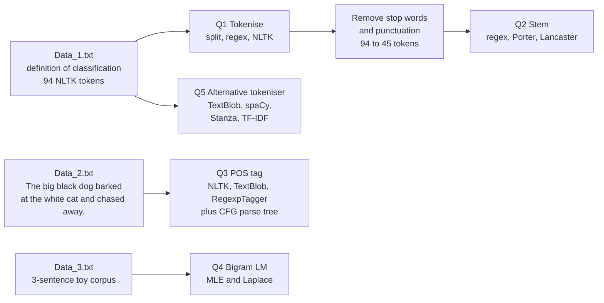
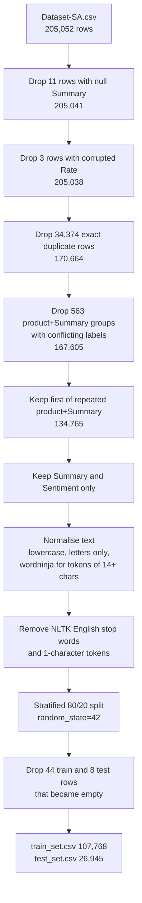
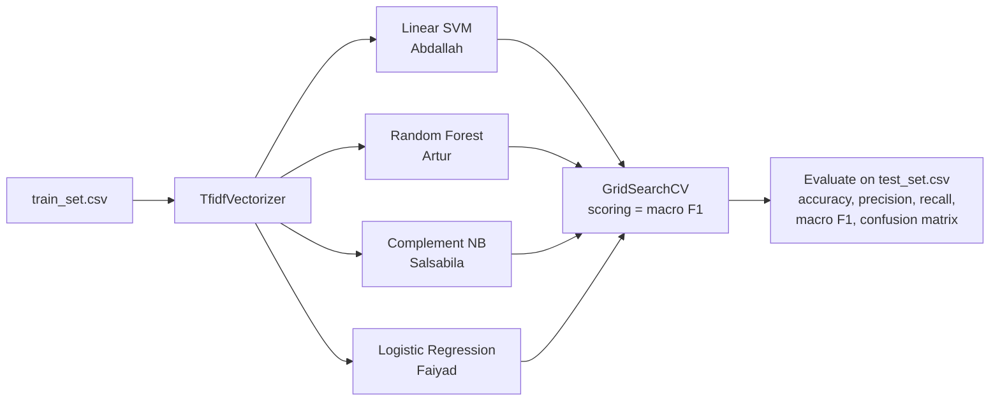

# Text Analytics and Sentiment Analysis (CT107-3-3-TXSA Group Project)

A four-person group assignment for the module **CT107-3-3-TXSA (Text Analysis and Sentimental Analysis)** at Asia Pacific University. It has two parts. **Part A** works through classical NLP tasks on three tiny texts: tokenisation, stop-word removal, stemming, POS tagging, parse trees and bigram language models. **Part B** is a complete sentiment-classification workflow on about 205,000 Flipkart product reviews: EDA, data cleaning, four supervised models (Linear SVM, Random Forest, Complement Naive Bayes, Logistic Regression), hyperparameter tuning with `GridSearchCV`, and evaluation on a shared hold-out set.

Everything lives in Jupyter notebooks, one per person per part, plus the data they read.

---

## Table of contents

1. [What it does](#what-it-does)
2. [Who did what](#who-did-what)
3. [Part A: classical NLP tasks](#part-a-classical-nlp-tasks)
4. [Part B: sentiment classification](#part-b-sentiment-classification)
5. [Results](#results)
6. [Project structure](#project-structure)
7. [Setup and run](#setup-and-run)
8. [Code walkthrough](#code-walkthrough)
9. [Data and privacy notes](#data-and-privacy-notes)
10. [Limitations and next steps](#limitations-and-next-steps)

---

## What it does

- Compares three ways to **tokenise** the same paragraph (`split()`, a regex, NLTK) and then four alternative tokenisers or vectorisers (TextBlob, spaCy, Stanza, scikit-learn TF-IDF), using the same punctuation, hyphen and vocabulary metrics.
- Removes stop words and punctuation, then **stems** the result with a hand-written regex stemmer, Porter and Lancaster.
- **POS-tags** one sentence with NLTK, TextBlob and a rule-based `RegexpTagger`, and draws a **parse tree** from a hand-written context-free grammar.
- Computes **sentence probability** with unsmoothed (MLE) and Laplace-smoothed bigram language models.
- Profiles a 205k-row review dataset (missing values, class imbalance, duplicates, noise, sparsity), cleans it, and saves a train and test split.
- Trains and tunes four classical classifiers on TF-IDF features and reports accuracy, precision, recall, macro F1 and confusion matrices.

| Technology | Role |
|---|---|
| Python 3.9 to 3.13 (per notebook metadata) | Language |
| Jupyter notebooks | Every deliverable |
| NLTK | Tokenisation, stop words, stemmers, POS tagging, CFG parsing, `nltk.lm` language models |
| TextBlob, spaCy (`en_core_web_sm`), Stanza | Alternative tokenisers |
| scikit-learn | `TfidfVectorizer`, `LinearSVC`, `RandomForestClassifier`, `ComplementNB`, `LogisticRegression`, `GridSearchCV`, metrics |
| pandas, NumPy, SciPy | Data handling and statistics |
| matplotlib, seaborn, wordcloud | EDA and result charts |
| wordninja | Splits words that were glued together in the reviews |

---

## Who did what

Each person owns one notebook per part. Names are taken from the notebook file names and headings.

| Person | Part A | Part B |
|---|---|---|
| Salsabila | Q1 tokenisation (`split`, regex, NLTK), stop-word removal; Q5 alternative: TF-IDF vectoriser | Q2 Complement Naive Bayes, Q3 tuning |
| Abdallah | Q2 stemming (regex, Porter, Lancaster); Q5 alternative: TextBlob | Q2 Linear SVM, Q3 tuning |
| Artur | Q3 POS tagging (3 methods) and parse tree; Q5 alternative: spaCy | Q2 Random Forest, Q3 tuning |
| Faiyad | Q4 bigram language models; Q5 alternative: Stanza | Q1 EDA and data preparation, Q2 Logistic Regression, Q3 tuning |

---

## Part A: classical NLP tasks

Part A uses three small input files in `Data/`.



### Q1: three tokenisers on `Data_1.txt` (Salsabila)

Metrics were computed with the same helper for every method. "Punctuation attached" counts tokens such as `input.` that still contain punctuation next to letters.

| Method | Tokens | Punctuation attached | Hyphenated words split | Unique tokens |
|---|---|---|---|---|
| `str.split()` | 82 | 13 | 0 | 55 |
| Regex `\b\w+\b` | 83 | 0 | 1 (`open-class`) | 50 |
| NLTK `word_tokenize` | 94 | 1 | 0 | 53 |
| TF-IDF vocabulary (Q5) | 45 | 0 | 1 | 45 |

The notebook concludes that NLTK is the best choice for downstream analytics because it keeps `open-class` intact and emits punctuation as separate tokens that can be filtered. Stop-word plus punctuation removal then reduces the 94 NLTK tokens to **45**.

### Q2: stemming (Abdallah)

The 45 filtered tokens are stemmed three ways. The regex stemmer is `^(.*?)(ing|ly|ed|ious|ies|ive|es|s|ment)?$`.

| Token | Regex | Porter | Lancaster |
|---|---|---|---|
| `classification` | classification | classif | class |
| `choosing` | choos | choos | choos |
| `jointly` | joint | jointli | joint |
| `defined` | defin | defin | defin |

### Q3: POS tagging and a parse tree (Artur)

For `The big black dog barked at the white cat and chased away.` NLTK `pos_tag`, TextBlob and a hand-written `RegexpTagger` produce the same Penn Treebank tags (`DT JJ JJ NN VBD IN DT JJ NN CC VBD RB`). TextBlob drops the final period. The notebook then explains the differences (statistical vs rule-based, tag sets, speed, use cases) and builds a grammar (`S -> NP VP Punc`, with PP and conjoined VP) that `nltk.ChartParser` turns into one parse tree.

### Q4: bigram language models (Faiyad)

Training corpus (`Data_3.txt`): `He read a book`, `I read a different book`, `He read a book by Danielle`. Test sentence: `I read a different book by Danielle`. Sentence markers are stripped and re-added by `padded_everygram_pipeline`; the vocabulary has 11 entries (10 tokens plus `<UNK>`).

| Bigram | MLE | Laplace (V = 11) |
|---|---|---|
| P(I given `<s>`) | 0.3333 | 0.1429 |
| P(read given I) | 1.0000 | 0.1667 |
| P(a given read) | 1.0000 | 0.2857 |
| P(different given a) | 0.3333 | 0.1429 |
| P(book given different) | 1.0000 | 0.1667 |
| P(by given book) | 0.3333 | 0.1429 |
| P(Danielle given by) | 1.0000 | 0.1667 |
| P(`</s>` given Danielle) | 1.0000 | 0.1667 |
| **Sentence probability** | **0.037037** (1/27) | **6.43e-07** |

The notebook states that the MLE result matches its manual calculation.

### Q5: alternative approaches to tokenisation

| Approach | Author | Tokens | Notes from the notebook |
|---|---|---|---|
| TextBlob `.words` | Abdallah | 82 | Drops punctuation, keeps `open-class`, 50 unique |
| spaCy `en_core_web_sm` | Artur | 97 | Includes a newline token, splits `open-class` into three tokens, 55 unique, 0.014 s |
| Stanza (tokenize only) | Faiyad | 96 | Splits `open-class`, 54 unique case-sensitive and 50 lowercased, 319.6 ms |
| scikit-learn `TfidfVectorizer` vocabulary | Salsabila | 45 | Lowercases, drops punctuation, splits hyphens |

Note that Artur's helper counts any token containing punctuation (including a lone `.`), so it reports 13 "punctuation attached" for NLTK and spaCy where Salsabila's helper reports 1 for NLTK. The two definitions are not interchangeable.

---

## Part B: sentiment classification

### The dataset

`Data/Dataset-SA.csv` (33 MB) is a table of Flipkart product reviews. The notebooks call it "Flipkart Product Reviews" and some review texts mention Flipkart; the repository does not record where the file came from or its licence.

| Column | Meaning |
|---|---|
| `product_name` | Product title (958 unique; contains encoding damage such as `??????`) |
| `product_price` | Price in INR (59 to 86,990 over the valid rows) |
| `Rate` | Star rating, 1 to 5 |
| `Review` | Short review title (about 1.9 words on average, 12% empty) |
| `Summary` | Review text (about 7.8 words on average, 11 empty). **Used as model input** |
| `Sentiment` | `positive`, `negative` or `neutral`. The prediction target |

Raw label balance: **positive 166,581 (81.2%), negative 28,232 (13.8%), neutral 10,239 (5.0%)** over 205,052 rows.

The EDA notebook shows a "1 to 2 stars negative, 3 stars neutral, 4 to 5 stars positive" mapping, but the `Sentiment` column does not follow that rule. Cross-tabulating the CSV shows, for example, 3-star reviews labelled 9,916 positive, 3,660 neutral and 3,023 negative, and 1,274 one-star reviews labelled positive. Treat the labels as provided by the dataset, not derived from stars.

### Data preparation (`Faiyad_PartB_EDA_DataPrep.ipynb`)



EDA findings that drove these choices (all from the notebook outputs):

| Finding | Value |
|---|---|
| Text columns | `Summary` chosen over `Review` (mean length 7.76 vs 1.90 words) |
| Numbers in Summary | 15,784 (7.7%), removed during normalisation |
| Concatenated tokens (14+ characters) | 3,950 summaries (1.9%), split with `wordninja` |
| Vocabulary | 41,885 unique words, 1,562,430 tokens, 0.02% of the vocabulary used per summary |
| Class balance after cleaning | positive 102,310 (75.9%), negative 24,744 (18.4%), neutral 7,711 (5.7%) |

Final files: `train_set.csv` (107,768 rows: 81,835 positive, 19,791 negative, 6,142 neutral) and `test_set.csv` (26,945 rows: 20,456 positive, 4,949 negative, 1,540 neutral). Both have two columns, `Summary_clean` and `Sentiment`, and every model notebook reads them.

### Models and tuning



All four use the same pipeline idea (`TfidfVectorizer` then classifier). Macro F1 is the headline metric because the classes are imbalanced.

| Model | Baseline setup | Search space | Search settings |
|---|---|---|---|
| Linear SVM | `TfidfVectorizer()` defaults, `LinearSVC()` | `C` [0.01 to 100], `loss` [hinge, squared_hinge], `max_iter` [1000, 3000, 5000] (30 combinations) | 5-fold, 150 fits |
| Random Forest | `TfidfVectorizer()` defaults, `RandomForestClassifier(random_state=42)` | `n_estimators` [100, 200, 300], `max_depth` [None, 10, 20], `min_samples_split` [2, 5, 10] (27 combinations) | 2-fold, 54 fits |
| Complement NB | TF-IDF (30,000 features, 1-2 grams, `min_df=2`, sublinear tf), `ComplementNB(alpha=1, norm=False)` | `max_features`, `ngram_range`, `min_df`, `alpha`, `norm` (64 combinations) | 5-fold, 320 fits |
| Logistic Regression | `TfidfVectorizer()` defaults, `LogisticRegression(class_weight='balanced')` | `max_features` [30000, None] and `C` [0.5, 1.0, 1.5, 2.0] with n-grams (1,2), sublinear tf, L2 and lbfgs fixed (8 combinations) | 3-fold, 24 fits |

Faiyad's tuning notebook first runs a "hyperparameter EDA" (class imbalance, summary length, document frequency, term-frequency skew, cross-class vocabulary overlap, C sensitivity on an 8k sample, vocabulary coverage) to justify the grid, and rejects `max_df`, custom domain stop words and `SelectKBest` after testing them.

---

## Results

All numbers below are the test-set results printed in each notebook (26,945 reviews). Per-class scores are precision / recall / F1.

| Model | Accuracy (base to tuned) | Macro F1 (base to tuned) | Best CV macro F1 | Best parameters |
|---|---|---|---|---|
| Linear SVM | 0.8830 to 0.8864 | 0.7083 to 0.7084 | 0.7171 | `C=1`, `loss=hinge`, `max_iter=1000` |
| Random Forest | 0.8940 to 0.8949 | 0.7343 to 0.7357 | 0.7191 | `n_estimators=200`, `max_depth=None`, `min_samples_split=2` |
| Complement NB | 0.8608 to 0.8774 | about 0.70 to 0.7133 | 0.7155 | `alpha=1.0`, `norm=True`, `max_features=20000`, `min_df=2`, `ngram_range=(1,2)` |
| Logistic Regression | not recorded | not recorded | not recorded | grid defined, outputs not saved (see limitations) |

Tuned per-class results:

| Model | Negative | Neutral | Positive |
|---|---|---|---|
| Linear SVM | 0.84 / 0.71 / 0.77 | 0.67 / 0.31 / 0.42 | 0.90 / 0.97 / 0.94 |
| Random Forest | 0.84 / 0.72 / 0.78 | 0.72 / 0.37 / 0.49 | 0.91 / 0.98 / 0.94 |
| Complement NB | 0.74 / 0.78 / 0.76 | 0.52 / 0.39 / 0.45 | 0.93 / 0.94 / 0.94 |

What the numbers say:

- Random Forest has the best test macro F1 (0.7357), but only by a small margin.
- Tuning barely moves the scores. The Linear SVM gains 0.0001 macro F1; Random Forest gains 0.0014. Complement NB gains the most (+0.013 macro F1, +0.017 accuracy).
- **Neutral is the hard class** for every model (recall 0.31 to 0.39 after tuning). In the tuned Complement NB confusion matrix (the only one printed as numbers), the 1,540 true neutral reviews are split into 443 predicted negative, 602 neutral and 495 positive. Accuracy is dominated by the 76% positive class.

---

## Project structure

```
Text-Analytics-NLP-Project-CT107/
├── Data/
│   ├── Data_1.txt              # Part A: paragraph on classification (Q1, Q2, Q5)
│   ├── Data_2.txt              # Part A: one sentence for POS tagging and parsing (Q3)
│   ├── Data_3.txt              # Part A: toy corpus and test sentence for bigram LM (Q4)
│   ├── Dataset-SA.csv          # Part B: raw Flipkart reviews, 205,052 rows (33 MB)
│   ├── train_set.csv           # Part B: cleaned training split, 107,768 rows
│   └── test_set.csv            # Part B: cleaned test split, 26,945 rows
└── Notebooks/
    ├── Salsabila_PartA.ipynb                  # Q1 tokenisation and stop words, Q5 TF-IDF
    ├── Abdallah_PartA.ipynb                   # Q2 stemming, Q5 TextBlob
    ├── Artur_PartA.ipynb                      # Q3 POS tagging and parse tree, Q5 spaCy
    ├── Faiyad_PartA_Q4_Q5(Stanza).ipynb       # Q4 bigram LM, Q5 Stanza
    ├── Faiyad_PartB_EDA_DataPrep.ipynb        # Q1 EDA and data preparation (writes train/test CSVs)
    ├── Faiyad_PartB_Q3_Q2_Final.ipynb         # Q2 Logistic Regression, Q3 tuning
    ├── Abdallah_PartB.ipynb                   # Q2 Linear SVM, Q3 tuning
    ├── Artur_PartB.ipynb                      # Q2 Random Forest, Q3 tuning
    ├── Salsabila_PartB.ipynb                  # Q2 Complement NB, Q3 tuning
    └── Temp.ipynb                             # empty placeholder file
```

---

## Setup and run

The repository has no `requirements.txt`; the list below is inferred from the notebook imports.

### 1. Prerequisites

- Python 3.10 or newer (the notebooks were run on 3.9 to 3.13)
- Jupyter (`notebook` or JupyterLab) or VS Code with the Jupyter extension

### 2. Install

```bash
python -m venv .venv
# Windows:      .venv\Scripts\activate
# macOS/Linux:  source .venv/bin/activate

pip install notebook nltk textblob spacy stanza scikit-learn pandas numpy scipy \
            matplotlib seaborn wordcloud wordninja
python -m spacy download en_core_web_sm
python -m nltk.downloader punkt punkt_tab stopwords averaged_perceptron_tagger
```

Newer NLTK and TextBlob releases may ask for extra resources (for example `averaged_perceptron_tagger_eng`); the error message names the one that is missing. Stanza downloads its English model with `stanza.download('en')` if it is not already present.

### 3. Run the notebooks

Open each notebook with `Notebooks/` as the working directory. They read data through relative paths such as `../Data/Data_1.txt`.

- **Part A:** the four `*_PartA*.ipynb` notebooks are independent. Run them top to bottom.
- **Part B:** `Faiyad_PartB_EDA_DataPrep.ipynb` regenerates `train_set.csv` and `test_set.csv`. The committed CSVs are already the output of that notebook, so you can skip it and run any model notebook directly.

Two things to know before you run:

- `Faiyad_PartA_Q4_Q5(Stanza).ipynb` loads `Data_1.txt` from an absolute path on the author's machine (`C:\Asia Pacific University\...`). Change that one cell to `../Data/Data_1.txt`.
- The tuning cells are slow. In the Random Forest notebook a single fit with `max_depth=None` took roughly 2 to 5 minutes, so the 54-fit grid takes a long time. Reduce the grid for a quick check.

---

## Code walkthrough

### Text normalisation (Part B data preparation)

```python
def normalise_text(text):
    text = str(text).lower()
    text = re.sub(r'[^a-z\s]', ' ', text)          # letters and spaces only
    words = text.split()
    # tokens of 14+ characters are probably two words glued together
    words = [' '.join(wordninja.split(w)) if len(w) >= 14 else w for w in words]
    return re.sub(r'\s+', ' ', ' '.join(words)).strip()
```

A real example from the notebook output:

| Stage | Text |
|---|---|
| Raw `Summary` | great cooler excellent air flow and for this price its so amazing and unbelievablejust love it |
| After normalisation | great cooler excellent air flow and for this price its so amazing and unbelievable just love it |
| After stop-word removal | great cooler excellent air flow price amazing unbelievable love |

### Model pipeline (Random Forest notebook)

```python
rf_pipeline = Pipeline([
    ('tfidf', TfidfVectorizer()),
    ('rf', RandomForestClassifier(random_state=42, n_jobs=-1)),
])
rf_pipeline.fit(X_train, y_train)

search = GridSearchCV(rf_pipeline,
                      {'rf__n_estimators': [100, 200, 300],
                       'rf__max_depth': [None, 10, 20],
                       'rf__min_samples_split': [2, 5, 10]},
                      cv=2, scoring='f1_macro', n_jobs=-1)
search.fit(X_train, y_train)
```

The TF-IDF vectoriser is part of the pipeline, so during cross-validation it is re-fitted on each training fold and never sees the validation fold.

---

## Data and privacy notes

- `Dataset-SA.csv` is **scraped-looking third-party e-commerce data**. Its source and licence are not recorded in the repository. Confirm that you may redistribute it before keeping it in a public repo; if not, replace it with a download link and keep only `train_set.csv` and `test_set.csv` if their terms allow it.
- The file has no reviewer-identity columns. A scan of the `Review` and `Summary` text found no email addresses or URLs and 10 phone-number-like strings in 205,052 rows (not individually checked).
- `product_name` contains encoding damage (`??????` and mis-decoded characters), so it is not safe to use as a clean key.
- Notebook outputs contain local file paths and user names (`C:\Users\...`, `/home/...`) from each contributor's machine. Consider clearing outputs or using `nbstripout` before publishing.
- Keep OS metadata and generated caches out of future commits.

---

## Limitations and next steps

- **Train and test overlap.** The split was done after de-duplicating by product and review text, so identical short texts that belong to different products remain. Checking the committed CSVs, **41.8% of test rows (11,258 of 26,945) have a text that also appears in the training set**, and the training set has only 69,352 distinct texts in 107,768 rows. Reported accuracy and F1 are therefore likely optimistic. De-duplicate on text alone before splitting, or split by product.
- **Weak neutral class.** Neutral recall is 0.31 to 0.41 across the models (base and tuned). Try class weighting, resampling, or a three-way model that uses `Review` and the star rating as extra features.
- **Labels are not star-derived.** See [the dataset section](#the-dataset). The labelling method is undocumented, so label noise is unknown.
- **Logistic Regression results are not stored.** `Faiyad_PartB_Q3_Q2_Final.ipynb` was saved without cell outputs, so its metrics cannot be read from the repository and are left out of the results table. Re-run it and save the outputs. Its hand-typed summary table (for example "mean 6.4 words", "skewness 81.9") is likewise not backed by stored output.
- **The four models are not configured identically.** The EDA notebook says `class_weight='balanced'` is applied to all four models, but the Linear SVM and Random Forest notebooks do not set it. Cross-validation folds also differ (5, 2, 5 and 3), and Complement NB's baseline already uses non-default TF-IDF settings. Compare models with care.
- **Hard-coded baseline.** In `Salsabila_PartB.ipynb` the "default" comparison row (macro F1 0.70) is typed in, not computed.
- **Part A inconsistency.** In `Salsabila_PartA.ipynb` the analysis text says NLTK leaves 13 tokens with punctuation attached, but the code output above it says 1.
- **Tiny Part A inputs.** The Part A metrics come from a single 94-token paragraph, so they illustrate behaviour rather than benchmark the tools.
- **Housekeeping.** Add a `requirements.txt`, replace the absolute path in the Stanza notebook, remove `Temp.ipynb`, and persist the best model (nothing is saved to disk today).
- **Next steps.** Add a transformer baseline (for example fine-tuned DistilBERT), run error analysis on the neutral class, and report confidence intervals or repeated runs for the small differences between tuned models.
